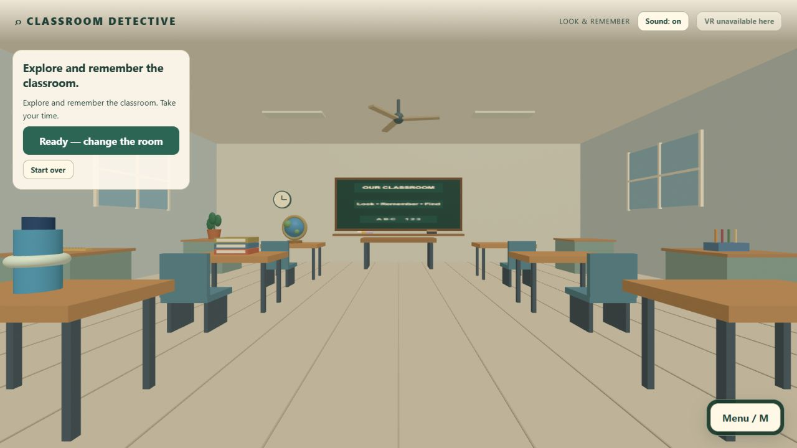
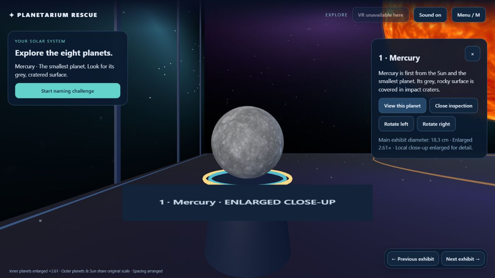
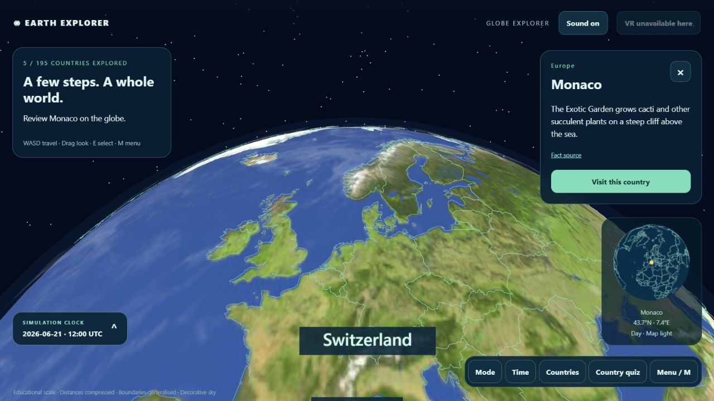

# Discovery Rooms

Interactive learning games for ages **10–15**, playable with keyboard and mouse or a WebXR headset such as Meta Quest 3.

[](https://github.com/Abhinashroy/discovery-rooms-vr/actions/workflows/ci.yml)

## Play online

[**Open Discovery Rooms**](https://abhinashroy.github.io/discovery-rooms-vr/) — keyboard/mouse or Quest Browser.

## Explore the rooms

| Classroom Detective                                                      | Planetarium Rescue                                                               | Earth Explorer                                                               |
| ------------------------------------------------------------------------ | -------------------------------------------------------------------------------- | ---------------------------------------------------------------------------- |
|                          |                                    |                   |
| Remember a classroom arrangement, then find four randomly moved objects. | Explore eight planets, assign their names, submit and take a five-question quiz. | Watch Sun/Earth/Moon motion, roam a miniature globe and learn country facts. |

- **Classroom:** a large furnished room, 13 movable props, random valid destinations, four findings per round, supplied opening/celebration clips and footsteps.
- **Planetarium:** textured exhibits, inspection at each planet, editable name assignments, one graded submission and five questions drawn from a pool of 30. The inner planets are enlarged for visibility.
- **Earth:** Orbit Observatory and Globe Explorer share one UTC clock. Travel as a giant, search all **195 countries**, read a sourced fact per country and unlock a five-question map/region/fact quiz after opening five cards. Includes a collapsible clock, distant stars/comets, footsteps and a completion Hooray.

Use **Menu → Main room** to choose another room. Leaving discards the current run. Switching Earth views retains its time and discoveries. Comfort preferences persist locally.

## Quick start

Requires **Node.js 24–26** and npm. No API key or Python installation is needed to play.

```sh
git clone https://github.com/Abhinashroy/discovery-rooms-vr.git
cd discovery-rooms-vr
npm ci
npm run dev
```

Open the printed address, usually <http://127.0.0.1:5173/>. Refresh an old tab with **Ctrl+Shift+R**. Stop the server with **Ctrl+C**.

## Controls

| Action            | Keyboard / mouse                            | Quest controllers                                  |
| ----------------- | ------------------------------------------- | -------------------------------------------------- |
| Travel            | WASD or Up/Down; drag to look               | Left stick                                         |
| Turn              | Mouse or Left/Right arrows                  | Right stick snap turn                              |
| Select            | Click, or E ahead                           | Trigger ray                                        |
| Menu              | M or Escape                                 | B/Y                                                |
| Earth travel      | WASD across the spherical surface           | Short faded steps; left trigger on Earth teleports |
| Earth information | Select a country or use the searchable list | Right trigger; paginated country destinations      |

In Planetarium and Earth VR, menus stay at their opening position while you look around. Close and reopen with B/Y to place them in front of you again. Controller-mounted menu/status boxes have been removed. Earth uses the headset's tracked eye height without the extra 1.5 m desktop lift. For country information, point at land and press the **right trigger**; the **left trigger** teleports.

Stationary navigation, reduced motion, larger text and mute are available. Physical walking is not required. A room change may require entering VR again.

For a headset, serve the build from HTTPS or use USB-forwarded localhost. See [Quest setup and deployment](docs/deployment.md).

## Development

```sh
npm run format:check
npm test
npm run build
npm run preview
```

The current suite has **109 tests**. The production build includes the selector, three rooms and four retained legacy entry pages. GitHub Actions runs formatting, tests and build on pushes and pull requests, and saves `dist/` as a downloadable build artifact. The separate **Deploy website** workflow publishes validated `main` builds to GitHub Pages.

Run `npm run format` to apply formatting. Country fact edits are regenerated with `npm run build:catalog`. See [Contributing](CONTRIBUTING.md) for the workflow.

```text
src/
  detective/          Classroom game
  planetarium/        Planet exhibits, naming and quiz
  earth-explorer/     Astronomy, globe, country content and quiz
  rooms/              Selector and shared navigation
public/               Local textures, map, audio and A-Frame
scripts/              Development, build and asset helpers
server/               Optional legacy tutor middleware
tests/               Automated checks
docs/                 Room specifications, architecture and device checks
```

Earlier applications remain at `/exploration.html`, `/classic.html`, `/computing.html` and `/authoring.html` with their source and regression tests. They are not offered by the current room selector. The three current rooms work without a live AI provider; `.env.example` belongs to the optional legacy tutor setup.

## Status and documentation

- [Current status and remaining acceptance checks](PROJECT_STATUS.md)
- [Earth Explorer specification](docs/EARTH-EXPLORER-CONCEPT.md)
- [Planetarium specification](docs/PLANETARIUM-RESCUE-PLAN.md)
- [Classroom specification](docs/ROOM-DETECTIVE-PLAN.md)
- [Architecture](docs/GAME-ARCHITECTURE.md)
- [Headset and learner validation](docs/headset-smoke-check.md)
- [Change history](CHANGELOG.md)

Desktop journeys verify the learning and quiz flow, movement and audio. **Actual Quest comfort, readability, frame stability and unfamiliar-learner validation remain pending.** Code tests do not establish learning benefit.

Earth is an approximate teaching model with adjusted sizes/distances. Country cards cover 193 UN members plus Holy See and Palestine; other mapped territories retain their geographic names. Boundaries are generalized, and region conventions are stated in the room.

## Assets and repository hygiene

Runtime assets are bundled locally with source/license manifests. See [Third-party notices](THIRD_PARTY_NOTICES.md). A project-wide open-source license has not yet been selected.

Generated builds, dependencies, local learner records, credentials, downloaded device tools, old release archives and duplicate hosting checkouts are ignored. Install dependencies with `npm ci` and create fresh output with `npm run build`; no historical ZIP is required.
